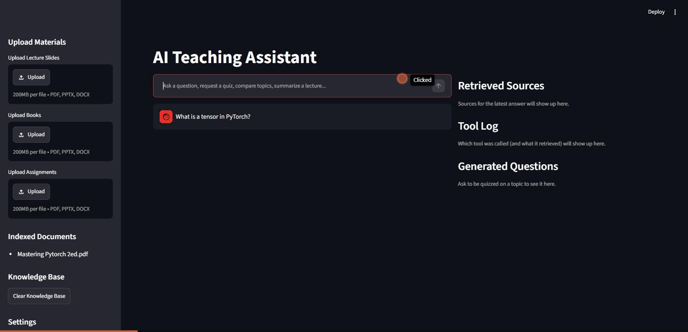
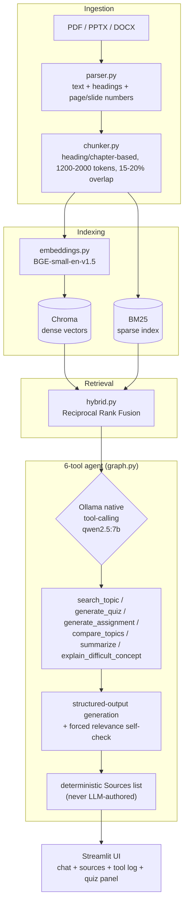

<div align="center">


# AI Teaching Assistant

**A local-first AI teaching assistant that answers strictly from a student's own uploaded course materials — never a guess.**

Runs entirely on-device via [Ollama](https://ollama.com/) by default — no cloud APIs, nothing leaves your machine — with an optional Gemini (cloud) mode for a zero-setup public demo. Built to `SPEC.md`'s requirements; see that file for the full specification this implements.

[](https://github.com/AbdullohRR/ai-teaching-assistant/actions/workflows/tests.yml)
[](https://www.python.org/)
[](https://streamlit.io/)
[-000000?logo=ollama&logoColor=white)](https://ollama.com/)
[](https://ollama.com/)
[](LICENSE)

</div>

---

## What is this?

If the retrieved materials don't cover a question, it says so explicitly
rather than guessing — grounding is enforced architecturally (see
[Anti-hallucination design](#anti-hallucination-design)), not just requested
via prompt. Ask things like:

> "Explain backpropagation using the slides I uploaded"
> "Quiz me on chapter 3"
> "Compare CNNs and Transformers based on my textbook"

...and get back an answer grounded only in what you actually uploaded, with
the exact source chunks it used — never a hallucinated guess from the
model's own pretrained knowledge.

## Demo

<div align="center">

</div>

*Real conversation, recorded against the actual running app — not a mockup.*

## Key features

| | |
|---|---|
| 🔍 **Hybrid retrieval** | Dense (Chroma + BGE-small) + BM25 keyword search, merged via Reciprocal Rank Fusion |
| 🛠️ **6-tool agent** | `search_topic`, `generate_quiz`, `generate_assignment`, `compare_topics`, `summarize`, `explain_difficult_concept` — routed automatically from plain-language questions |
| 🚫 **Won't guess** | A forced per-chunk relevance self-check refuses to answer from content that isn't actually there — see [Anti-hallucination design](#anti-hallucination-design) |
| 📌 **Deterministic citations** | The `Sources:` list is built from retrieved-chunk metadata, never transcribed by the LLM itself |
| 🔒 **100% local by default** | Runs entirely on Ollama — no data leaves your machine, no API key required |
| ☁️ **Optional cloud mode** | Gemini fallback for a zero-setup public demo, BYOK (bring your own key) |

## Tech stack

- **Retrieval:** ChromaDB (dense vectors), `BAAI/bge-small-en-v1.5` embeddings, `rank_bm25` (BM25 sparse), Reciprocal Rank Fusion
- **Generation:** Ollama running `qwen2.5:7b-instruct` locally (native tool-calling), optional Gemini via its OpenAI-compatible endpoint
- **Ingestion:** PyMuPDF, `python-pptx`, `python-docx` — parses PDFs/slides/docs into heading-aware chunks with page/slide metadata
- **Frontend:** Streamlit — chat, sources panel, tool-call log, quiz panel

## How it works — architecture



**Pipeline**: every one of the 6 tools retrieves via the same hybrid
(dense + sparse, RRF-fused) retriever before generating anything — no tool
answers from the model's own pretrained knowledge.

## Anti-hallucination design

This was the hardest part to get right and took real iteration to verify,
not just assume:

- **Forced per-chunk relevance self-check.** The model's structured output
  schema requires it to explicitly assess each retrieved chunk as
  `RELEVANT`/`NOT_RELEVANT` *before* producing any answer content. This is
  the single change that fixed the worst failure mode (fully answering a
  genuinely off-topic question using irrelevant retrieved content) —
  a numeric similarity threshold alone doesn't work: in testing, a
  deliberately off-topic query still scored only marginally lower than
  genuine matches.
- **Citations are never LLM-authored.** The model reports which numbered
  chunks it actually used; the `Sources:` list is then built deterministically
  from that chunk's own metadata. The model never transcribes a citation
  itself, which removes an entire class of citation-hallucination risk
  (wrong page numbers, invented filenames).
- **A relative-relevance gate on retrieval itself.** Padding chunks that
  are far weaker than the top hit (< 50% of its score) are dropped before
  the model ever sees them, rather than relying on the model to visually
  pick signal out of noise in a mixed batch.
- **Two deterministic guards need no LLM judgment at all**: an empty
  knowledge base short-circuits before any model call, and a chunk with
  zero real BM25 term overlap is never treated as a meaningfully "ranked"
  candidate in fusion.

## Setup

### Requirements

- Python 3.11
- [Ollama](https://ollama.com), running locally
- ~6GB VRAM (tested on an RTX 4050 laptop GPU) or CPU (slower)

### Install

```powershell
cd ai-teaching-assistant
py -3.11 -m venv .venv
.\.venv\Scripts\pip install -r requirements.txt

ollama pull qwen2.5:7b-instruct-q4_K_M
# if that's too slow on your GPU, fall back to the smaller model:
# ollama pull qwen2.5:3b-instruct-q4_K_M
# and change OLLAMA_MODEL in config.py to match
```

### Run

```powershell
.\.venv\Scripts\streamlit.exe run main.py
```

Prefer a cloud model, or want a public demo? The optional Gemini path and
Streamlit Community Cloud hosting are in [Deployment](docs/DEPLOYMENT.md) —
along with why the grounding guarantees are only proven on the local path.

## Project structure

```
app/
  agent/      graph.py (orchestration, grounding checks) · nodes.py · tools.py
  rag/        parser.py (PDF/PPTX/DOCX → text + page/slide/heading metadata)
              chunker.py · embeddings.py · retriever.py · hybrid.py (BM25 + RRF)
  memory/     rolling conversation-history trimming
  ui/         Streamlit page and panel components
tests/        automated pytest — chunker, BM25 retrieval, RRF fusion (run in CI)
scripts/      cli.py, plus manual verification scripts run by hand against real files
```

Full annotated tree: [`docs/PROJECT-STRUCTURE.md`](docs/PROJECT-STRUCTURE.md).
The requirements this implements are in [`SPEC.md`](SPEC.md).

## Testing

Two different, deliberately non-overlapping layers:

- **`tests/` (automated, CI-run)** — real `pytest` assertions for the parts
  of the pipeline that are pure deterministic logic: chunking's
  grouping/merging/splitting/back-matter-exclusion rules, BM25 keyword
  search, and the RRF fusion formula. `count_tokens` and the chunk-size
  thresholds are monkeypatched to a cheap word-count proxy in
  `test_chunker.py` so these run in milliseconds with no network call and
  no `transformers`/`torch` install — they're testing the *structural
  logic*, not the real tokenizer's exact counts. Run with:
  ```
  pip install -r requirements-dev.txt
  pytest
  ```
- **`scripts/test_*.py` (manual, not CI)** — the embedding model, the LLM
  (`qwen2.5:7b-instruct` via Ollama), and real course-material relevance
  can't be meaningfully asserted against; these scripts index real sample
  files (gitignored, not in the repo — see `data/samples/`) and print full
  output so a human can eyeball retrieval relevance, chunk topic coherence,
  and answer grounding directly. Run individually, e.g.
  `.venv/Scripts/python.exe scripts/test_retriever.py`, with Ollama running
  locally for the two that call the LLM (`test_all_tools.py`,
  `test_search_topic.py`).

## What's been verified against real files

Each stage was tested against real multi-language (Uzbek/Russian/English)
lecture slides, a 129-page textbook, a tabular DOCX, and a 559-page
English-language technical book with zero embedded table of contents (so
heading detection had to rely entirely on the font/bold/position heuristic)
— not just unit tests with synthetic input. See `scripts/test_*.py` for the
verification scripts themselves.

Also specifically re-verified after the chunking-quality fixes: the same
question asked repeatedly returns the same answer and sources; an
off-topic question is refused rather than answered from the model's own
knowledge; and a broad conceptual query that used to incorrectly return
"not found" (because the content it needed was mislabeled under an
unrelated front-matter heading) now retrieves and answers correctly.

## Known limitations

Being direct about these rather than glossing over them:

- **The embedding model (`BAAI/bge-small-en-v1.5`, one of SPEC's own two
  suggested options) is English-only.** It handles Uzbek reasonably well in
  practice (shared Latin script, many recognizable roots), but a specific
  Uzbek phonetic transliteration of a loanword (tested case: "blokcheyn" for
  "blockchain") can retrieve only unrelated content where the English
  spelling would have found the right material. A multilingual embedding
  model would likely resolve this, at the cost of re-verifying the whole
  retrieval pipeline again.
- **Qwen2.5 at Q4_K_M quantization occasionally drifts into Chinese
  mid-answer** for longer/more complex generations in lower-resource target
  languages — a documented characteristic of its heavily Chinese-weighted
  training data. A detect-and-retry-once mitigation is in place; it helps
  but doesn't eliminate it entirely.
- **List/enumeration questions can still occasionally add an unlisted item**
  from the model's own general knowledge despite an explicit instruction
  not to, though outright fabricating unrelated content (the more serious
  failure mode) is what the relevance self-check specifically targets and
  reliably prevents.
- **Generation latency varies noticeably** with available VRAM headroom —
  observed anywhere from ~10s to several minutes on a 6GB GPU depending on
  what else is using it at the time.
- **Determinism is very high but not absolute.** Generation runs at
  temperature 0 with a fixed seed, and retrieval (dense + BM25 + RRF) is
  fully deterministic given the same indexed content, so the same question
  reliably produces the same answer and citations in the vast majority of
  runs. GPU floating-point matrix operations don't guarantee a fixed
  reduction order, though, so a repeated run can rarely still land on a
  different token. Observed once in many dozens of test runs, not
  reproducible on demand.
- **PDF heading detection is page-granular, not position-granular.** Each
  PDF page becomes one chunk-eligible unit with a single detected heading
  (see `parser.py`'s `_detect_pdf_heading`). If a real section heading
  starts partway down a page, the text *above* it on that same page (which
  actually belongs to the previous section) still gets attributed to the
  new heading's chunk. This was significantly reduced by widening heading
  detection from "top 15% of the page only" to the whole content area
  (previously, real headings appearing mid-page — common in dense technical
  books — were being missed entirely, which was silently mislabeling dozens
  of consecutive pages under one earlier heading). The remaining drift is
  bounded to at most one page per heading, rather than accepted as a
  non-issue: fixing it fully would mean splitting page text at the
  heading's exact position rather than treating each page as one atomic
  unit, which risks corrupting text extraction on multi-column or
  image-heavy layouts — a large enough behavior change that it's left as a
  documented limitation rather than fixed speculatively.

## Documentation

| | |
|---|---|
| [SPEC.md](SPEC.md) | The requirements this implements |
| [Project structure](docs/PROJECT-STRUCTURE.md) | Full annotated tree |
| [Deployment](docs/DEPLOYMENT.md) | The optional Gemini path and Streamlit Cloud hosting, and what is not verified there |

## License

[MIT](LICENSE)
